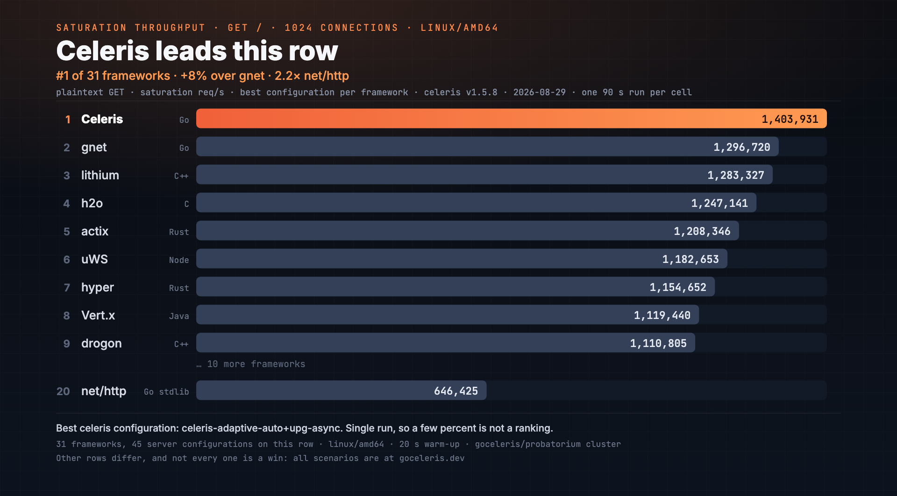

<!--
HEADLINE ALTERNATIVES (decision pending; the rendered README keeps lead A until the release bot decides). Delete this block when decided.

LEAD A (rendered now, in Performance):
  "On plaintext GET with 1024 connections on linux/amd64, celeris's best configuration ranked first of [[PLACEHOLDER: N frameworks, v1.6.0 amd64 run]] frameworks: [[PLACEHOLDER: margin over the next server, v1.6.0 amd64 run]] ahead of the next server and [[PLACEHOLDER: ratio]] times net/http."

LEAD B (bolder; use ONLY if every item of the checklist in the PR description holds in the v1.6.0 runs):
  "celeris is the highest-throughput HTTP server we have measured: [[PLACEHOLDER: N frameworks, v1.6.0 amd64 run]] frameworks in 10 languages, including the C, C++, Rust and Java servers, on plaintext GET. [[PLACEHOLDER: conditions in the next sentence: row, 1024 connections, linux/amd64, run date, margins over gnet, fiber, net/http, lithium, h2o and actix, and the arm64 result in the same breath]]"
  Never: "in the world", "fastest" without the field, or a ranking nobody measured.
-->

<p align="center">
  
</p>

<p align="center">
  <a href="https://github.com/goceleris/celeris/actions/workflows/ci.yml?query=branch%3Amain"></a>
  <a href="https://codecov.io/gh/goceleris/celeris"></a>
  <a href="https://scorecard.dev/viewer/?uri=github.com/goceleris/celeris"></a>
  <a href="https://www.bestpractices.dev/projects/15387"></a>
  <a href="https://pkg.go.dev/github.com/goceleris/celeris"></a>
  <a href="https://github.com/goceleris/celeris/releases/latest"></a>
  <a href="go.mod"></a>
  <a href="LICENSE"></a>
</p>

<p align="center">
  <strong>celeris is a Go HTTP engine that serves HTTP/1.1 and cleartext HTTP/2 from per-core epoll or io_uring event loops, with a route-group and middleware API in the spirit of Gin and Echo.</strong><br>
  It ships PostgreSQL, Redis and memcached clients, in beta, and is validated on a real x86-64 and arm64 cluster.
</p>

<p align="center">
  <a href="#quick-start">Quick start</a> ·
  <a href="#performance">Performance</a> ·
  <a href="#status-and-stability">Status</a> ·
  <a href="https://goceleris.dev">Documentation</a> ·
  <a href="https://pkg.go.dev/github.com/goceleris/celeris">API reference</a> ·
  <a href="CONTRIBUTING.md">Contributing</a>
</p>

## Why celeris

- **Event loops, not a goroutine per connection.** On Linux, pinned per-core loops on epoll or io_uring; `Adaptive`, the default, switches between them under load. `Std` runs on `net/http` for development and other systems.
- **A familiar API.** Route groups, named parameters, middleware, error-returning handlers, and `celeris.Adapt` to reuse a `net/http` handler.
- **46 middleware packages in the repository.** Authentication, CORS, sessions, rate limiting, caching, compression, Prometheus and OpenTelemetry.
- **Database clients.** First-party PostgreSQL, Redis and memcached clients, in beta, no CGo ([details](https://goceleris.dev/docs/data-stores)).
- **Streaming.** WebSocket with a fan-out `Hub`, Server-Sent Events with a `Broker`, `StreamWriter` and `Detach`.
- **Allocation discipline.** Request contexts are pooled and the core request paths are held to zero allocations by tests.
- **Small dependency surface.** The root module depends directly on `golang.org/x/sys` and `golang.org/x/net` only.

## Quick start

```
go get github.com/goceleris/celeris@latest
```

```go
package main

import (
	"log"

	"github.com/goceleris/celeris"
)

func main() {
	s := celeris.New(celeris.Config{Addr: ":8080"})
	s.GET("/hello", func(c *celeris.Context) error {
		return c.String(200, "Hello, World!")
	})
	log.Fatal(s.Start())
}
```

Requires **Go 1.27.3+** (the `go` directive in `go.mod` is the source of truth). The io_uring, epoll and adaptive engines need Linux; the std engine runs on any OS (see [Platform support](https://goceleris.dev/docs/runtime-notes#platform-support)). Routing, middleware, configuration and the rest are below.

## Performance

<p align="center">
  
</p>

<!-- RELEASE: replace the chart and its caption with the v1.6.0 run: python3 .github/scripts/benchmark-hero.py <docs>/results/v1.6.0/<date>/x86_64/summary.json > hero.html, render it (Chrome command in the script header), then refill the headline sentence and the table below from .github/scripts/analyze-published-results.py <docs> v1.6.0 <date>. The full-results page (goceleris/docs results.md) is derived from the same script: update it in the same release, and when the data is from loadgen v1.4.14 or later delete its clause "leaving out the HTTP/2 rows and `churn-close` (loadgen v1.4.14 fixed the clients behind them)". -->
<p align="center"><em>Plaintext GET, 1024 connections, requests per second, linux/amd64, best configuration per framework. One row of the published v1.5.8 results (2026-08-29).</em></p>

On plaintext GET with 1024 connections on linux/amd64, celeris's best configuration ranked first of [[PLACEHOLDER: number of frameworks, v1.6.0 amd64 run]] frameworks: [[PLACEHOLDER: percent ahead of the next server, v1.6.0 amd64 run]] ahead of the next server and [[PLACEHOLDER: ratio, v1.6.0 amd64 run]] times `net/http`. The last published run (v1.5.8, 2026-08-29, one 90 s run per cell) had it first of 31 frameworks, 8% ahead of gnet, a networking library, and 2.2 times `net/http`.

| Requests per second, plaintext GET, 1024 connections | v1.6.0 | v1.5.8 |
|---|---|---|
| amd64: celeris, best configuration | [[PLACEHOLDER: rps, amd64 run]] | 1,403,931 |
| amd64: gnet, the next server overall (a networking library) | [[PLACEHOLDER: rps, amd64 run]] | 1,296,720 |
| amd64: fiber, best other Go web framework | [[PLACEHOLDER: rps, amd64 run]] | 1,040,338 |
| amd64: `net/http` | [[PLACEHOLDER: rps, amd64 run]] | 646,425 |
| arm64: celeris, best configuration | [[PLACEHOLDER: rps, arm64 run]] | 430,146 |
| arm64: fiber | [[PLACEHOLDER: rps, arm64 run]] | 252,509 |
| arm64: `net/http` | [[PLACEHOLDER: rps, arm64 run]] | 143,504 |

<!-- RELEASE: re-derive this list from the final v1.6.0 runs at tag time. An item whose issue has closed disappears; nothing stays because it was in the draft. -->
**Where celeris is not ahead.**

- On arm64 the same row is a tie with gnet (430,146 against 420,047 in v1.5.8), and a single run's few percent is within noise.
- Tail latency at partial load on amd64: the p99 of 64 KiB WebSocket echo with the default garbage collector ([#756](https://github.com/goceleris/celeris/issues/756); the opt-in `Config.GCPercent` narrows the gap at about twice the memory on epoll) and of HTTP/2 JSON GET ([#757](https://github.com/goceleris/celeris/issues/757)) is higher than the std engine's.
- On arm64, WebSocket echo p99 at light load on the epoll, io_uring and adaptive engines is 1.8 to 2.03 times that of the std engine in the same run (about 0.71 to 0.91 ms against 0.42 ms, one host, cause unknown, not closed in v1.6.0; [#755](https://github.com/goceleris/celeris/issues/755), [#1318](https://github.com/goceleris/celeris/issues/1318)).
- Database rows are mixed: on arm64 the memcached rows trail fasthttp ([#857](https://github.com/goceleris/celeris/issues/857)), loop-engine throughput on big.LITTLE arm64 is still being confirmed ([#1036](https://github.com/goceleris/celeris/issues/1036)), and WebSocket hub-broadcast p99 on amd64 is higher ([#858](https://github.com/goceleris/celeris/issues/858)).

The figures come from a cross-framework benchmark of 52 configurations of 31 frameworks on dedicated x86-64 and arm64 machines, driven by one load generator ([loadgen](https://github.com/goceleris/loadgen)) from a separate host, and a cell is one run. No tail-latency ranking is claimed from these runs: their latency passes carry a known load-generator limit ([loadgen#102](https://github.com/goceleris/loadgen/issues/102)). [How the numbers are made](https://goceleris.dev/methodology/); [full results and how to read them](https://goceleris.dev/docs/results).

## Status and stability

- **Releases.** v1.6.0 is the first release with a written [compatibility promise](GOVERNANCE.md#compatibility): the exported API follows the Go 1 promise within v1, checked in CI against the golden files in [`api/`](api/). v1.6.0 itself breaks earlier releases.
- **Drivers (beta).** The PostgreSQL, Redis and memcached clients are beta: the exported API stays under the compatibility check, but behaviour fixes (what a value scans to, which cases return an error) may land in minor releases and are listed in the release notes. Supported types and gaps per driver: [PostgreSQL](https://goceleris.dev/docs/postgres-types), [Redis](https://goceleris.dev/docs/redis-replies), [memcached](https://goceleris.dev/docs/memcached-behavior).
- **Maturity.** celeris is a young project with one maintainer. Run it behind a TLS-terminating proxy and benchmark it on your own workload; TLS in-process is [#446](https://github.com/goceleris/celeris/issues/446).
- **Platforms.** Linux is the production platform: io_uring needs 5.19 or later, epoll 5.10 or later. macOS and Windows run the std engine for development and testing.
- **Security.** Report vulnerabilities as [SECURITY.md](SECURITY.md) describes.
<!-- RELEASE: re-derive at tag time from the issues then open: an item whose issue has closed disappears, and the list of v1.6.0-milestone items still open is added; nothing stays because it was in the draft. -->
- **Known open, planned for v1.6.1.**
  - PostgreSQL: no decoder for `time`, `interval`, `inet`, `cidr`, `macaddr`, `oid` and ranges ([#1352](https://github.com/goceleris/celeris/issues/1352)); multi-dimensional arrays are an error ([#1350](https://github.com/goceleris/celeris/issues/1350)); arrays into `string` or `[]byte` ([#1351](https://github.com/goceleris/celeris/issues/1351)); `float8` loses digits when `extra_float_digits` is 0 or less ([#1364](https://github.com/goceleris/celeris/issues/1364)); arguments rejected with an error ([#1347](https://github.com/goceleris/celeris/issues/1347), [#1348](https://github.com/goceleris/celeris/issues/1348), [#1349](https://github.com/goceleris/celeris/issues/1349), [#1359](https://github.com/goceleris/celeris/issues/1359), [#1361](https://github.com/goceleris/celeris/issues/1361)); a cached statement after `ALTER COLUMN TYPE` ([#1360](https://github.com/goceleris/celeris/issues/1360)); context and cancel cases ([#1375](https://github.com/goceleris/celeris/issues/1375), [#1382](https://github.com/goceleris/celeris/issues/1382), [#1383](https://github.com/goceleris/celeris/issues/1383), [#1384](https://github.com/goceleris/celeris/issues/1384), [#1389](https://github.com/goceleris/celeris/issues/1389), [#1391](https://github.com/goceleris/celeris/issues/1391), [#1392](https://github.com/goceleris/celeris/issues/1392)).
  - All drivers: a context that ends while the pool dials returns `dial tcp ...: i/o timeout` ([#1396](https://github.com/goceleris/celeris/issues/1396)). Redis: `ClusterClient` ([#1397](https://github.com/goceleris/celeris/issues/1397)), `MGet` and `HMGet` on a missing key ([#1406](https://github.com/goceleris/celeris/issues/1406)), writes above the per-write limit ([#1357](https://github.com/goceleris/celeris/issues/1357)).
  - Engines: idle CPU cost, about 1.7% of a CPU with 3 epoll loops on one arm64 VM ([#1381](https://github.com/goceleris/celeris/issues/1381)); `Workers: 1` is refused ([#1379](https://github.com/goceleris/celeris/issues/1379)); drivers opened `WithEngine` before `Start` with `Engine` unset ([#1376](https://github.com/goceleris/celeris/issues/1376)); light-load p99 ([#1380](https://github.com/goceleris/celeris/issues/1380)). Middleware: the `timeout` context's reported deadline ([#1393](https://github.com/goceleris/celeris/issues/1393)).

## What's new in v1.6.0

- **Breaking.** The minimum Go version is 1.27.3, the engine, protocol and driver codec packages moved under `internal/`, and deprecated APIs were removed; the release notes list every migration.
- **Compatibility.** The exported API is covered by a written promise and checked against `api/` golden files in CI.
- **Correctness.** The io_uring and epoll shutdown, teardown and park paths and the HTTP/2 connection bounds were audited and corrected.
- **New.** `HEAD` and `OPTIONS` are answered automatically, an opt-in `Config.GCPercent` exists for large-message WebSocket p99, and the drivers build and run on Windows.
- **Changed defaults.** Request bodies are limited to 4 MiB, `SO_BUSY_POLL` is opt-in (`Config.SocketBusyPoll`), and swagger serves embedded assets.

[Release notes](https://github.com/goceleris/celeris/releases/tag/v1.6.0).

## Routing

```go
s := celeris.New(celeris.Config{Addr: ":8080"})

// Static routes
s.GET("/health", healthHandler)

// Named parameters
s.GET("/users/:id", func(c *celeris.Context) error {
	id := c.Param("id")
	return c.JSON(200, map[string]string{"id": id})
})

// Catch-all wildcards
s.GET("/files/*path", staticFileHandler)

// Route groups with middleware
api := s.Group("/api")
api.Use(authMiddleware)
api.GET("/items", listItems)
api.POST("/items", createItem)

// Named routes + reverse URL generation
s.GET("/users/:id", showUser).Name("user")
url, _ := s.URL("user", "42") // "/users/42"

// Pre-routing middleware (runs before route matching)
s.Pre(methodOverride, urlRewrite)
```

## Middleware

All middleware is in-tree under [`middleware/`](middleware/), documented at [goceleris.dev](https://goceleris.dev/docs/middleware): `adapters`, `basicauth`, `bodylimit`, `cache`, `circuitbreaker`, `compress`, `cors`, `csrf`, `debug`, `etag`, `healthcheck`, `idempotency`, `jwt`, `keyauth`, `logger`, `methodoverride`, `metrics`, `otel`, `overload`, `pprof`, `protobuf`, `proxy`, `ratelimit`, `recovery`, `redirect`, `requestid`, `rewrite`, `secure`, `session`, `singleflight`, `sse`, `static`, `store`, `swagger`, `timeout` and `websocket`. `compress`, `metrics`, `otel` and `protobuf` are separate modules. `pprof`'s profile and trace endpoints hold an I/O worker for their duration: mount it as an `.Async()` route.

```go
import (
	"github.com/goceleris/celeris/middleware/cors"
	"github.com/goceleris/celeris/middleware/logger"
	"github.com/goceleris/celeris/middleware/recovery"
)

s := celeris.New(celeris.Config{Addr: ":8080"})
s.Use(recovery.New())
s.Use(logger.New())
s.Use(cors.New())
```

## Error handling

`HandlerFunc` has the signature `func(*Context) error`. Returning a non-nil error propagates it up through the middleware chain. If no middleware handles it, the router's safety net converts it to an HTTP response:

- `*HTTPError` — responds with its `Code` and `Message`.
- Any other `error` — responds with `500 Internal Server Error`.

```go
// Return a structured HTTP error
s.GET("/item/:id", func(c *celeris.Context) error {
	item, err := store.Find(c.Param("id"))
	if err != nil {
		return celeris.NewHTTPError(404, "item not found").WithError(err)
	}
	return c.JSON(200, item)
})

// Use Status() + StatusJSON() for fluent responses
s.POST("/items", func(c *celeris.Context) error {
	var item Item
	if err := c.Bind(&item); err != nil {
		return celeris.NewHTTPError(400, "invalid body").WithError(err)
	}
	created := store.Create(item)
	return c.Status(201).StatusJSON(created)
})
```

## Configuration

```go
s := celeris.New(celeris.Config{
	Addr:               ":8080",
	Protocol:           celeris.Auto,      // HTTP1, H2C, or Auto
	Engine:             celeris.Adaptive,  // IOUring, Epoll, Adaptive, or Std
	Workers:            8,
	ReadTimeout:        30 * time.Second,
	WriteTimeout:       30 * time.Second,
	IdleTimeout:        120 * time.Second,
	ShutdownTimeout:    10 * time.Second,  // max wait for in-flight requests (default 30s)
	MaxRequestBodySize: 50 << 20,          // 50 MB (default 4 MiB, -1 for unlimited)
	AsyncHandlers:      false,             // server-level default (per-route .Async() overrides)
	Logger:             slog.Default(),
})
```
Every field is documented on [goceleris.dev](https://goceleris.dev/docs/configuration). The opt-in `Config.GCPercent` is described on the [WebSocket page](https://goceleris.dev/docs/websocket#large-messages-and-the-garbage-collector).

## Async handlers and streaming

Handlers run inline on the I/O worker by default. Mark a route that blocks on I/O `.Async()` so the worker stays free; precedence is route over group over `Config.AsyncHandlers`. An inline handler must not call `runtime.Goexit` (`t.FailNow` does): on the native engines it ends that event loop for good. Details are in [Runtime notes](https://goceleris.dev/docs/runtime-notes).

```go
// CPU-only / cache-only — runs inline (default).
s.GET("/healthz", healthHandler)

// Blocking I/O — async, runs on a per-conn goroutine.
s.GET("/db", dbHandler).Async()

// Or flip the default at the group level:
api := s.Group("/api").Async()
api.GET("/products", productHandler)     // async (inherited)
api.GET("/cached", cachedHandler).Sync() // opt back to sync
```

`StreamWriter()` streams on every engine; `Detach()` keeps a connection alive after the handler returns, on the native engines only. [`middleware/websocket`](middleware/websocket) (with a fan-out `Hub`) and [`middleware/sse`](middleware/sse) (with a `Broker` and Last-Event-ID replay) build on them; see [Streaming](https://goceleris.dev/docs/streaming).

## Database drivers

[`driver/postgres`](driver/postgres), [`driver/redis`](driver/redis) and [`driver/memcached`](driver/memcached) are first-party clients, in beta, with no CGo and no TLS (connect over a trusted network or a TLS sidecar). Which connections run on the server's event loops depends on how you open them: see [Data stores](https://goceleris.dev/docs/data-stores) and [Runtime notes](https://goceleris.dev/docs/runtime-notes#database-drivers-and-event-loops).

## net/http compatibility

```go
s.GET("/legacy", celeris.Adapt(legacyHandler))
s.GET("/func", celeris.AdaptFunc(func(w http.ResponseWriter, r *http.Request) {
	w.Write([]byte("from stdlib"))
}))
```

The bridge buffers the adapted handler's response in memory, up to 100 MB.

## Engines

| Engine | Platform | Use |
|--------|----------|-----|
| `IOUring` | Linux 5.19+ | Completion-based I/O |
| `Epoll` | Linux 5.10+ | Readiness-based I/O |
| `Adaptive` | Linux 5.10+ | Starts on epoll and moves to io_uring under sustained load where the kernel allows it (6.1+ with the fast-tier probes, or 6.10+) |
| `Std` | Any OS | Development, compatibility, TLS through a listener |

The default is `Adaptive` on Linux and `Std` elsewhere. Neither native engine is faster everywhere. TLS is not terminated in-process on the native engines: terminate it upstream. Tuning variables, busy polling, CPU pinning and the feature matrix are on [Engines](https://goceleris.dev/docs/engines), [Runtime notes](https://goceleris.dev/docs/runtime-notes) and [CPU pinning](https://goceleris.dev/docs/cpu-pinning).

## Graceful shutdown

Use `StartWithContext` for production; when the context is cancelled the server drains in-flight requests up to `ShutdownTimeout` (default 30s).

```go
ctx, stop := signal.NotifyContext(context.Background(), os.Interrupt, syscall.SIGTERM)
defer stop()

s := celeris.New(celeris.Config{
	Addr:            ":8080",
	ShutdownTimeout: 15 * time.Second,
})
s.GET("/hello", helloHandler)

if err := s.StartWithContext(ctx); err != nil {
	log.Fatal(err)
}
```

A connection that has begun a request head and not finished it (a fragment, or a bare CRLF) counts as a request in progress on epoll and io_uring. `Shutdown` waits for it until the head completes, until `ReadHeaderTimeout` (10 s by default, from the head's first byte, or for a new connection from its accept) or `WriteTimeout` cuts it, or until the context passed to `Shutdown` is done, so a client can hold a graceful shutdown for that long and the caller's bound is the context's deadline. The std engine differs: std closes a keep-alive connection in that state with the idle ones, and waits for a new connection's first head as for a silent one. The per-engine contract is in the [`Server.Shutdown`](https://pkg.go.dev/github.com/goceleris/celeris#Server.Shutdown) godoc.

## Observability

The core provides a lightweight metrics collector via `Server.Collector()`:

```go
snap := server.Collector().Snapshot()
fmt.Println(snap.RequestsTotal, snap.ErrorsTotal, snap.ActiveConns, snap.CPUUtilization)
```

For Prometheus exposition and debug endpoints, use [`middleware/metrics`](middleware/metrics) and [`middleware/debug`](middleware/debug). For OpenTelemetry, use [`middleware/otel`](middleware/otel).

## Requirements

- **Go 1.27.3+** (the `go` directive in `go.mod`); build with 1.27.4 or later: Go 1.27.3's `net/http` carries [GO-2026-6859](https://pkg.go.dev/vuln/GO-2026-6859) (an HTTP/1 server whose handler uses `MaxBytesReader` can crash), which matters for the std engine and for handlers you wrap with `celeris.Adapt`. celeris itself does not call `MaxBytesReader`.
- **Linux** for the native engines; any OS for the std engine.

## Continuous validation

[probatorium](https://github.com/goceleris/probatorium) runs every reference app on every engine on both architectures against malformed traffic, connection churn and fault injection, with invariants checked each second. On celeris pull requests the required checks are Lint (with the `api/` check), Unit, Conformance, Driver Conformance, Build and a vulnerability check. [[PLACEHOLDER: validation verdicts on the release commit, written at tag time]]

## Related projects

- **[loadgen](https://github.com/goceleris/loadgen)**: the load generator behind the benchmarks.
- **[probatorium](https://github.com/goceleris/probatorium)**: the benchmark and validation harness.
- **[docs](https://github.com/goceleris/docs)**: the source of [goceleris.dev](https://goceleris.dev).

## Contributing

See [CONTRIBUTING.md](CONTRIBUTING.md).

## License

[Apache License 2.0](LICENSE)
