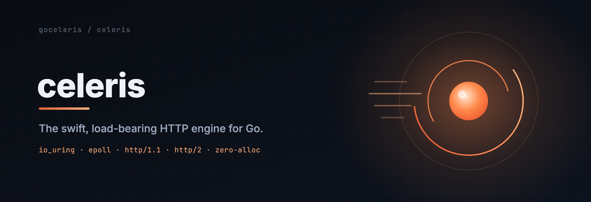
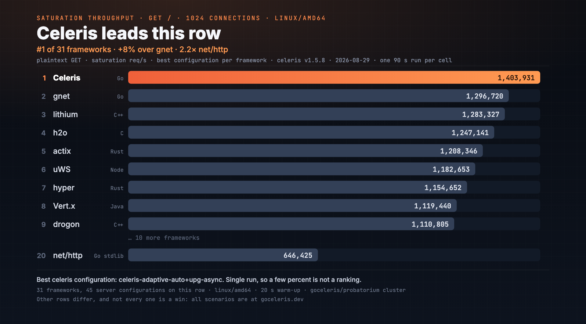

<p align="center">
  
</p>

# celeris

[](https://github.com/goceleris/celeris/actions/workflows/ci.yml)
[](https://github.com/goceleris/probatorium/actions/workflows/matrix-nightly-tier.yml?query=branch%3Amain)
[](https://github.com/goceleris/probatorium/actions/workflows/matrix-weekend-tier.yml?query=branch%3Amain)
[](https://pkg.go.dev/github.com/goceleris/celeris)
[](https://goreportcard.com/report/github.com/goceleris/celeris)
[](LICENSE)
[](https://www.bestpractices.dev/projects/15387)

celeris is a high-throughput, load-bearing HTTP engine for Go, built on a protocol-aware dual architecture of io_uring and epoll. Its standout strength is throughput under load: across the [probatorium](https://github.com/goceleris/probatorium) cross-framework matrix it leads the field on driver-backed (PostgreSQL / Redis / memcached) and write-heavy workloads, sustaining the highest request rates while holding tail-latency SLOs — powered by first-party database drivers that run their socket I/O on the same event loop as your handlers. The API is a familiar route-group and middleware model in the spirit of Gin and Echo, so teams adopt it without learning a new programming model, with zero-allocation hot paths on the HTTP/1.1 and h2c fast paths.

Full documentation lives at [goceleris.dev](https://goceleris.dev).

## Highlights

- **io_uring and epoll at parity** — both native engines deliver equivalent throughput; an adaptive meta-engine picks and transplants between them at runtime.
- **Inline broadcast egress** (v1.5.7) — WebSocket and SSE fan-out now writes inline on the dispatch goroutine on native engines, lifting the single-loop-thread broadcast ceiling.
- **Zero hot-path allocations** on the HTTP/1.1 and h2c fast paths — pool-based contexts and pre-encoded HPACK responses.
- **First-party event-loop drivers** — native PostgreSQL, Redis, and memcached clients that colocate socket I/O with your handlers, no CGo, no separate reactor.
- **Continuously validated** — an adversarial [probatorium](https://github.com/goceleris/probatorium) cluster matrix runs nightly, plus a deeper weekend soak; see the badges above.

## What's new in v1.6.0

An engine-correctness release, driven by what the [probatorium](https://github.com/goceleris/probatorium) matrix found rather than by features. io_uring: the async-mode teardown and transplant paths were audited end to end and fixed (dead connection states left on the dirty list, a ring SEND still in flight when a connection was handed to epoll, short-submit accounting, detached-count drift, a pause/resume that armed a second recv and corrupted WebSocket streams, `Metrics` racing `Listen`), live heap retained on the refapp that serves both WebSocket and SSE, and a SEND_ZC probe that could never detect copy fallback. epoll: receive drains are bounded. All engines: bytes arriving on a detached connection are no longer parsed as a new request, detached WebSocket connections get a liveness bound, and the HTTP/2 worker pool no longer starves later streams once every worker holds a streaming handler. The std engine regained the h2c Upgrade handshake, so the three engines agree again, and `EnableH2Upgrade` now means the same on all of them: on `Protocol: H2C` the std engine upgrades an `Upgrade: h2c` request only with `EnableH2Upgrade: &true` (it used to by default), and on `Protocol: HTTP1` `&true` upgrades there too. Middleware: the rate limiter's eviction actually runs, `basicauth` hashes with a salt, and struct request binding with validation is new. Dependencies: `golang.org/x/net` 0.59. **Breaking:** the engine, protocol and driver codec packages moved under `internal/` and can no longer be imported; [Compatibility](GOVERNANCE.md#compatibility) says what is supported from v1.6.0 on.
## Features

- **Tiered io_uring** — auto-selects the best io_uring feature set (multishot accept/recv, provided buffers, SQ poll, fixed files) for your kernel.
- **Edge-triggered epoll** — per-core event loops with CPU pinning.
- **Adaptive meta-engine** — transplants between io_uring and epoll at runtime based on telemetry.
- **First-party database drivers** — native [`driver/postgres`](driver/postgres), [`driver/redis`](driver/redis), and [`driver/memcached`](driver/memcached) run on the celeris event loop (see [Database drivers](#database-drivers)).
- **Zero-copy HTTP/1.1 parser** — the parser returns header and body slices that alias the bytes it parses instead of copying them. On epoll and io_uring, a request that arrives whole in one read, with no body or a `Content-Length` body, and runs inline is parsed in place in the engine's read buffer; a request that spans reads, has a chunked body, or runs on an async handler is served from a per-connection buffer instead.
- **HTTP/2 cleartext (h2c)** — full stream multiplexing, flow control, HPACK, inline handler execution, zero-alloc HEADERS fast path.
- **Auto-detect** — protocol negotiation from the first bytes on the wire.
- **Error-returning handlers** — `HandlerFunc` returns `error`; structured `*HTTPError` carries status codes.
- **Pre-routing middleware** — `Server.Pre()` runs middleware before route matching (method override, URL rewrite).
- **Serialization** — JSON and XML response methods; `Bind` auto-detects request format from `Content-Type`.
- **net/http compatibility** — wrap an existing `http.Handler` via `celeris.Adapt()` / `celeris.AdaptFunc()`.
- **Streaming responses** — `StreamWriter()` for chunked incremental writes on any engine; `Detach()` for keep-alive-after-return streaming on native engines (see [Streaming](#streaming-sse--websocket--chunked)).
- **Connection hijacking** — `Hijack()` for custom protocol upgrades (HTTP/1.1 only).
- **Engine-integrated WebSocket** — `UpgradeWebSocket()` hands the conn to the worker loop with backpressure, permessage-deflate, and a `Hub` for fan-out broadcast.
- **Response buffering** — `BufferResponse` / `FlushResponse` for transform middleware (compress, ETag, cache).
- **File serving** — `File()` from the OS, `FileFromFS()` from `embed.FS` / `fs.FS`.
- **Content negotiation** — `Negotiate`, `Respond`, `AcceptsEncodings`, `AcceptsLanguages`.
- **Configurable body limits** — `MaxRequestBodySize` enforced on HTTP/1.1 and h2c (default 4 MiB; the net/http bridge has two fixed 100 MB caps: `ToHandler` on the request body, `Adapt` on the adapted handler's buffered response).
- **100-continue control** — `OnExpectContinue` callback validates uploads before the body transfers.
- **Accept control** — `PauseAccept()` / `ResumeAccept()` for graceful load shedding. A pause carries clients that have connected but not yet sent their request: it keeps the listen sockets open for about 1.5 s with `TCP_DEFER_ACCEPT` cleared before closing them, and blocks for that long; set `DisableDeferAccept` for a pause that closes at once ([#662](https://github.com/goceleris/celeris/issues/662), [#675](https://github.com/goceleris/celeris/issues/675)).
- **Zero-downtime restart** — `InheritListener` + `StartWithListener` for socket inheritance.
- **Built-in metrics** — atomic counters, CPU-utilization sampling, on by default via `Server.Collector().Snapshot()` (opt out with `Config.DisableMetrics`).
- **Per-route async dispatch** — `Route.Async()` / `Route.Sync()` choose inline-on-worker vs. per-conn dispatch goroutine per route; h2 chooses per stream.

**TLS:** celeris is cleartext by design: TLS is terminated at the edge. The io_uring and epoll engines speak HTTP/1.1 and h2c only, and there is no `ListenTLS`. Terminate TLS upstream (Caddy, Nginx, Envoy, a cloud load balancer). If you need HTTPS in-process, run the std engine and pass a TLS listener: `Engine: celeris.Std` with `StartWithListener(tls.NewListener(ln, cfg))` serves HTTPS over HTTP/1.1, at the std engine's performance. The database drivers are cleartext too (see [Database drivers](#database-drivers)). First-class TLS is tracked in [#446](https://github.com/goceleris/celeris/issues/446).

## Quick start

```
go get github.com/goceleris/celeris@latest
```

Requires **Go 1.27.3+** (the `go` directive in `go.mod` is the source of truth). Linux for the io_uring / epoll / adaptive engines; any OS for the std engine. On Windows the server (std engine) and the database drivers build and run for development and testing; Linux is the supported production platform (see [Platform support](#platform-support)).

```go
package main

import (
	"log"

	"github.com/goceleris/celeris"
)

func main() {
	s := celeris.New(celeris.Config{Addr: ":8080"})
	s.GET("/hello", func(c *celeris.Context) error {
		return c.String(200, "Hello, World!")
	})
	log.Fatal(s.Start())
}
```

## Routing

```go
s := celeris.New(celeris.Config{Addr: ":8080"})

// Static routes
s.GET("/health", healthHandler)

// Named parameters
s.GET("/users/:id", func(c *celeris.Context) error {
	id := c.Param("id")
	return c.JSON(200, map[string]string{"id": id})
})

// Catch-all wildcards
s.GET("/files/*path", staticFileHandler)

// Route groups with middleware
api := s.Group("/api")
api.Use(authMiddleware)
api.GET("/items", listItems)
api.POST("/items", createItem)

// Named routes + reverse URL generation
s.GET("/users/:id", showUser).Name("user")
url, _ := s.URL("user", "42") // "/users/42"

// Pre-routing middleware (runs before route matching)
s.Pre(methodOverride, urlRewrite)
```

## Middleware

All middleware is in-tree under [`middleware/`](middleware/) — 46 importable packages: the root `middleware` package, the 36 below, and 9 store and cache sub-packages:

| Package | Description |
|---------|-------------|
| [`adapters`](middleware/adapters) | Bidirectional stdlib ↔ celeris middleware/handler conversion |
| [`basicauth`](middleware/basicauth) | HTTP Basic authentication with hashed password support |
| [`bodylimit`](middleware/bodylimit) | Request body size enforcement |
| [`cache`](middleware/cache) | HTTP response cache with singleflight + Cache-Control honoring |
| [`circuitbreaker`](middleware/circuitbreaker) | Circuit breaker (3-state, sliding-window error rate, 503 + Retry-After) |
| [`compress`](middleware/compress) | Response compression (zstd, brotli, gzip, deflate; separate go.mod) |
| [`cors`](middleware/cors) | Cross-Origin Resource Sharing (zero-alloc) |
| [`csrf`](middleware/csrf) | CSRF protection (double-submit cookie + origin validation) |
| [`debug`](middleware/debug) | Debug / introspection endpoints (loopback-only by default) |
| [`etag`](middleware/etag) | Automatic ETag generation and conditional 304 responses |
| [`healthcheck`](middleware/healthcheck) | Kubernetes-style liveness / readiness / startup probes |
| [`idempotency`](middleware/idempotency) | Idempotency-Key replay protection (in-flight 409 + cached replay) |
| [`jwt`](middleware/jwt) | JWT authentication (HMAC / RSA / ECDSA / EdDSA, JWKS auto-refresh) |
| [`keyauth`](middleware/keyauth) | API-key authentication with constant-time comparison |
| [`logger`](middleware/logger) | Structured request logging (slog, zero-alloc FastHandler) |
| [`methodoverride`](middleware/methodoverride) | HTTP method override via header or form field |
| [`metrics`](middleware/metrics) | Prometheus metrics (separate go.mod) |
| [`otel`](middleware/otel) | OpenTelemetry tracing + metrics (separate go.mod) |
| [`overload`](middleware/overload) | 5-stage CPU + queue-depth + tail-latency-EMA overload control (503 + Retry-After) |
| [`pprof`](middleware/pprof) | Go profiling endpoints (loopback-only by default) |
| [`protobuf`](middleware/protobuf) | Protobuf serialization with content negotiation (separate go.mod) |
| [`proxy`](middleware/proxy) | Trusted-proxy header extraction (X-Forwarded-For, X-Real-IP) |
| [`ratelimit`](middleware/ratelimit) | Sharded token-bucket / sliding-window rate limiter (Redis / memcached store adapters) |
| [`recovery`](middleware/recovery) | Panic recovery with broken-pipe detection |
| [`redirect`](middleware/redirect) | URL redirect / rewrite (HTTPS, www, trailing slash) |
| [`requestid`](middleware/requestid) | Request-ID generation (buffered UUID v4) |
| [`rewrite`](middleware/rewrite) | Regex-based URL rewriting with capture-group support |
| [`secure`](middleware/secure) | Security headers (HSTS, CSP, COOP/CORP/COEP, OWASP defaults) |
| [`session`](middleware/session) | Cookie-based sessions on the unified [`store.KV`](middleware/store) (memory / Redis / Postgres / memcached adapters) |
| [`singleflight`](middleware/singleflight) | Request coalescing (collapse identical in-flight requests) |
| [`sse`](middleware/sse) | Server-Sent Events: heartbeat, Last-Event-ID replay, per-client slow-client policy, and a `Broker` for fan-out (see [Streaming](#streaming-sse--websocket--chunked)) |
| [`static`](middleware/static) | Static file serving with directory browse, ETag / Last-Modified caching |
| [`store`](middleware/store) | Unified in-memory `KV` (sharded, TTL eviction) shared by session / csrf / ratelimit / cache / idempotency; Redis / Postgres / memcached adapters live under the respective `session/*store` and `ratelimit/*store` subpackages |
| [`swagger`](middleware/swagger) | OpenAPI spec + Swagger UI (embedded) / Scalar / ReDoc (pinned CDN, opt-in) |
| [`timeout`](middleware/timeout) | Request timeout with cooperative and preemptive modes |
| [`websocket`](middleware/websocket) | RFC 6455 WebSocket: permessage-deflate, engine-integrated backpressure, and a `Hub` for fan-out (see [Streaming](#streaming-sse--websocket--chunked)) |

```go
import (
	"github.com/goceleris/celeris/middleware/cors"
	"github.com/goceleris/celeris/middleware/logger"
	"github.com/goceleris/celeris/middleware/recovery"
)

s := celeris.New(celeris.Config{Addr: ":8080"})
s.Use(recovery.New())
s.Use(logger.New())
s.Use(cors.New())
```

Middleware with external dependencies lives in its own module — import it separately:

```go
import "github.com/goceleris/celeris/middleware/metrics" // requires prometheus
import "github.com/goceleris/celeris/middleware/otel"    // requires opentelemetry
```

## Error handling

`HandlerFunc` has the signature `func(*Context) error`. Returning a non-nil error propagates it up through the middleware chain. If no middleware handles it, the router's safety net converts it to an HTTP response:

- `*HTTPError` — responds with its `Code` and `Message`.
- Any other `error` — responds with `500 Internal Server Error`.

```go
// Return a structured HTTP error
s.GET("/item/:id", func(c *celeris.Context) error {
	item, err := store.Find(c.Param("id"))
	if err != nil {
		return celeris.NewHTTPError(404, "item not found").WithError(err)
	}
	return c.JSON(200, item)
})

// Use Status() + StatusJSON() for fluent responses
s.POST("/items", func(c *celeris.Context) error {
	var item Item
	if err := c.Bind(&item); err != nil {
		return celeris.NewHTTPError(400, "invalid body").WithError(err)
	}
	created := store.Create(item)
	return c.Status(201).StatusJSON(created)
})
```

## Configuration

```go
s := celeris.New(celeris.Config{
	Addr:               ":8080",
	Protocol:           celeris.Auto,      // HTTP1, H2C, or Auto
	Engine:             celeris.Adaptive,  // IOUring, Epoll, Adaptive, or Std
	Workers:            8,
	ReadTimeout:        30 * time.Second,
	WriteTimeout:       30 * time.Second,
	IdleTimeout:        120 * time.Second,
	ShutdownTimeout:    10 * time.Second,  // max wait for in-flight requests (default 30s)
	MaxRequestBodySize: 50 << 20,          // 50 MB (default 4 MiB, -1 for unlimited)
	AsyncHandlers:      false,             // server-level default (per-route .Async() overrides)
	Logger:             slog.Default(),
})
```

## Async handlers (per route)

Celeris runs every handler **inline on the I/O worker** by default — lowest latency, zero handoff. For handlers that block on I/O (database, RPC, filesystem), opt **per route** into the per-connection dispatch goroutine so the worker stays free to drive other connections:

```go
// CPU-only / cache-only — runs inline (default).
s.GET("/healthz", healthHandler)

// Blocking I/O — async, runs on a per-conn goroutine.
s.GET("/db", dbHandler).Async()

// Or flip the default at the group level:
api := s.Group("/api").Async()
api.GET("/products", productHandler)     // async (inherited)
api.GET("/cached", cachedHandler).Sync() // opt back to sync
```

Precedence is **route > group > server default** (`Config.AsyncHandlers`). It works identically across io_uring, epoll, and adaptive — both sub-engines honor the per-route flag, and async promotions survive sub-engine swaps: a conn is promoted **once** via the `ErrAsyncDispatch` sentinel (sticky — subsequent requests skip the inline check entirely). h2 routes the choice **per stream** between inline-on-event-loop and the shared h2 worker pool. The `Async` / `Sync` distinction is a no-op on the std engine, where net/http already does goroutine-per-request.

**An inline handler must not call `runtime.Goexit`.** `t.FailNow`, `t.Fatal` and `t.SkipNow` in a test's handler call it, and so do some libraries. A panic is caught (the router answers 500), but a Goexit cannot be: on epoll, io_uring and adaptive an inline handler runs on the event-loop goroutine, so a Goexit ends that loop for good. Every connection the loop owns goes unserved and its `SO_REUSEPORT` listener stops accepting. The engine logs an Error (`... ended without returning`, with the engine, the loop or worker id and the connection count) and cannot recover. A `.Async()` route's handler does not run on the loop, so the loop survives a Goexit there, but the cost depends on the protocol: on HTTP/1.1 the native engines close that connection and log an Error; on HTTP/2 the stream gets no response and no RST_STREAM, nothing is logged, and the connection stays open (the client waits for its own timeout). On HTTP/2 a stream of a sync route runs inline whether or not its request has a body, so a Goexit there ends the loop and is logged; the one exception is a connection that already holds 4 MiB of response data it could not send for the peer's window, where the stream runs on the h2 worker pool and ends silently, as an `.Async()` route's does. A request that matches no route runs its global middleware and its `NotFound` or `MethodNotAllowed` handler inline whatever the routes are marked (with `Config.AsyncHandlers` set, until a blocking run promotes them), and the `OnConnect` and `OnDisconnect` callbacks run on the loop too, as does `OnExpectContinue` unless its connection was promoted to async dispatch: none of them may call `runtime.Goexit`. The std engine runs each request on its own goroutine, so a Goexit there ends only that request's goroutine (net/http closes an HTTP/1.1 connection whose handler Goexits), not a loop.

Observe how often the inline → goroutine handoff fires via `Server.EngineInfo().Metrics.AsyncRoutes` (static count of `.Async()` routes) and `.AsyncPromotedConns` (cumulative promotions).

## Streaming (SSE / WebSocket / chunked)

Streaming is a first-class differentiator, and native engines get an inline egress path that avoids funneling every write through one loop thread. Four building blocks compose:

- **`Context.StreamWriter()`** — synchronous incremental writes (chunked / progressive responses). Works on **every** engine, including std.
- **`Context.Detach()`** — keep the connection alive after the handler returns, so a spawned goroutine can drive a long-lived stream. This is **native-engine only** (io_uring / epoll / adaptive). On std, the connection closes the moment the handler returns.
- **[`middleware/websocket`](middleware/websocket)** — RFC 6455 WebSocket with an engine-integrated `Hub` for broadcast.
- **[`middleware/sse`](middleware/sse)** — Server-Sent Events with a `Broker` for publish-to-N fan-out and Last-Event-ID replay.

Gate async streaming on the active engine with `Context.EngineSupportsAsyncDetach()` — it reports whether the engine can keep the conn alive after the handler returns:

```go
func stream(c *celeris.Context) error {
	if c.EngineSupportsAsyncDetach() {
		done := c.Detach()
		go func() {
			defer done()
			driveStream(c) // writes flush through the engine's guarded path
		}()
		return nil // handler returns; conn stays alive
	}
	driveStream(c) // std: must complete before returning
	return nil
}
```

### WebSocket

[`middleware/websocket`](middleware/websocket) is a full RFC 6455 implementation wired directly into the worker loop:

- **Zero-alloc reads** — `Conn.ReadMessageReuse()` reuses a caller buffer for echo / proxy hot paths.
- **Streaming large messages** — `Conn.NextReader()` / `Conn.NextWriter()` read and write without whole-message buffering.
- **Control frames** — `Conn.WriteControl()`, `Conn.WritePing()`, and `SetPingHandler` / `SetPongHandler` / `SetCloseHandler`.
- **permessage-deflate** — RFC 7692 compression negotiated at handshake (`EnableCompression`).
- **Fan-out `Hub`** — `NewHub(HubConfig{...})`, then `Broadcast` / `BroadcastFilter` / `BroadcastPrepared`. Encode once with `NewPreparedMessage` and reuse the `*PreparedMessage` across every subscriber for O(1) per-message wire-encoding cost. Slow connections are handled by `HubConfig.OnSlowConn`, which returns a `HubPolicy` (Drop / Remove / Close).

### SSE

[`middleware/sse`](middleware/sse) provides heartbeats, Last-Event-ID replay via a pluggable `ReplayStore`, and a fan-out `Broker`:

- **`NewBroker(BrokerConfig{...})`** — publish to N subscribers, each with a bounded queue.
- **`BrokerConfig.OnSlowSubscriber`** — returns a `BrokerPolicy` (Drop / Remove / Close) when a subscriber's queue is full; slow-subscriber handling is bounded by `DefaultBrokerSlowConcurrency()` (`GOMAXPROCS*4`) so a misbehaving callback can't fan out unboundedly.
- **Last-Event-ID replay** — on reconnect the broker reads `Since(lastID)` from the replay store and re-sends missed events.

## Database drivers

Celeris ships first-party, event-loop-native database drivers that run their socket I/O on the **same worker loop** as your HTTP handlers — no CGo, no separate reactor thread. They back the driver-isolation benchmarks and probatorium's driver-backed workloads, where celeris's dominance is widest.

- **[`driver/postgres`](driver/postgres)** — speaks the PostgreSQL v3 wire protocol directly. Register it as a standard `database/sql` driver, or use the lower-level worker-affinity `Pool` to skip `database/sql` overhead.
- **[`driver/redis`](driver/redis)** — RESP2 / RESP3 client (negotiates `HELLO 3` with automatic RESP2 fallback), per-worker connection pools, pub/sub, and Redis Cluster + Sentinel failover.
- **[`driver/memcached`](driver/memcached)** — text and binary protocols, pooled single-node clients, and a consistent-hash cluster with failover.

Colocate a driver with the server via its `WithEngine` option so commands issue on the loop instead of dialing out on a blocking goroutine. See [goceleris.dev](https://goceleris.dev) for driver guides.

The drivers have no TLS stack: connect them over a trusted network (loopback, a VPC, a private link) or through a TLS sidecar. They refuse rather than silently downgrade when TLS is mandatory:
- Postgres returns `ErrSSLNotSupported` for `sslmode=require`, `verify-ca` and `verify-full`. `prefer` and `allow` connect in plaintext and print a warning.
- Redis rejects `rediss://` addresses.
- Memcached has no TLS option.

Driver-side TLS is part of [#446](https://github.com/goceleris/celeris/issues/446).

### Platform support

The drivers (and the middleware stores built on them: CSRF, JWT cache, rate limit and session stores over Redis, Postgres and memcached) run on the celeris event loop on **Linux**, which is the supported production path and the one the benchmarks measure. On macOS and the other unix hosts they run on a goroutine-per-connection fallback for development and testing.

On **Windows** the drivers and every store compile (`GOOS=windows go build ./...` and `go vet ./...` pass over the whole module), and work through the same kind of portable fallback: each connection is a `net.Conn` read by its own goroutine, with no `WithEngine` colocation, no write queue and no tuning. CI cross-compiles for windows/amd64 and windows/arm64 and runs the fallback's tests and the drivers' fake-server tests on `windows-latest` (the integration suites against real Redis, Postgres and memcached run on Linux only). Windows is not benchmarked and not a production target: deploy on Linux.

## net/http compatibility

Wrap existing `net/http` handlers and middleware:

```go
// Wrap http.Handler
s.GET("/legacy", celeris.Adapt(legacyHandler))

// Wrap http.HandlerFunc
s.GET("/func", celeris.AdaptFunc(func(w http.ResponseWriter, r *http.Request) {
	w.Write([]byte("from stdlib"))
}))
```

The bridge buffers the adapted handler's response in memory, capped at a compile-time **100 MB** limit (independent of `Config.MaxRequestBodySize`). Responses exceeding this limit return an error.

## Engine selection

| Engine | Platform | Use case |
|--------|----------|----------|
| `IOUring` | Linux 5.19+ | Lowest latency, highest throughput |
| `Epoll` | Linux 5.10+ | Broad kernel support, proven stability |
| `Adaptive` | Linux 5.10+ | Auto-switch between io_uring and epoll on telemetry; epoll only below 5.19 |
| `Std` | Any OS | Development, compatibility, non-Linux deploys |

The default is **Adaptive** on Linux and **Std** elsewhere. Prefer Adaptive unless you have a specific reason to pin an engine; on non-Linux platforms only Std is available (the native engines return an error).

io_uring needs Linux 5.19 or later: every cancel the engine submits uses the `IORING_ASYNC_CANCEL` flags that release added, and an older kernel fails each one with `-EINVAL` ([#682](https://github.com/goceleris/celeris/issues/682)). The engine checks it at startup: a kernel version before 5.19 is refused outright (a partial vendor backport can pass a single probe cancel while its other cancel forms still fail), and from 5.19 a probe cancel that the kernel answers decides. Where the kernel version is below 5.19 or the kernel rejects the flags, `IOUring` fails to start with an error that names the requirement, and `Adaptive` runs on epoll (`CELERIS_ADAPTIVE_START=iouring` included).

### Tuning environment variables

The engines read these at startup. None is needed for normal operation; to run a single engine with no switching, set `Config.Engine` instead. The Stability column is the level [GOVERNANCE.md](GOVERNANCE.md#compatibility) defines: a **supported** variable keeps its name, values and effect within v1; an **experimental** one may change in a minor release, with a release note; an **unsupported** one may change or go away in any release.

| Variable | Engine | Stability | Values (default in bold) | Effect |
|----------|--------|-----------|--------------------------|--------|
| `CELERIS_ADAPTIVE_START` | Adaptive | supported | `epoll`, `iouring`, **`auto`** | Chooses the engine Adaptive **starts** on. It does not turn off runtime switching. Unrecognized values mean `auto`. `iouring` is a request: where the io_uring engine cannot be built (`CELERIS_MAX_IOURING_TIER=none`, say), Adaptive logs a `WARN` and starts on epoll. |
| `CELERIS_MAX_IOURING_TIER` | io_uring | supported | `optional`, `high`, `base`, `none` (**unset: detected tier**) | Caps the io_uring feature tier below what the kernel supports; for exercising fallback paths. Any other non-empty value, typos included, counts as `none` (an empty value is the same as unset). At `none` the io_uring engine reports io_uring as unavailable, and Adaptive's automatic choice neither starts on io_uring nor switches to it. An explicit `CELERIS_ADAPTIVE_START=iouring` still tries io_uring first: the engine refuses, Adaptive logs one `WARN` (`io_uring start engine unavailable, falling back to epoll start`) and starts on epoll, and the switch to io_uring stays off. The detected kernel version is not capped. |
| `CELERIS_IOURING_SEND_ZC` | io_uring | supported | `on`/`1`/`true`, `off`/`0`/`false`, **`auto`** | Zero-copy send. `auto` enables it where the startup probe finds SEND_ZC working; `on` cannot enable it where the probe failed. Unrecognized values mean `auto`; one is logged as a warning only where the probe finds SEND_ZC working (elsewhere the variable has no effect). |
| `CELERIS_IOURING_MULTISHOT_RECV` | io_uring | experimental | `1` (**unset: off**) | Multishot receive into a provided-buffer ring (high tier, 5.19+). Any value other than `1` leaves it off. |
| `CELERIS_IOURING_PBUF_COUNT` | io_uring | experimental | positive integer (**1024**) | Provided-buffer-ring entries per worker; used only with multishot receive. Rounded up to a power of two and clamped to 1024–32768. `0`, a negative value or a non-integer keeps the default. |
| `CELERIS_IOURING_FIXED_FILES` | io_uring | unsupported | **do not set** | Development only. Fixed-file support is incomplete ([#541](https://github.com/goceleris/celeris/issues/541)); enabling it makes connections read from unrelated descriptors. |

Variables named `CELERIS_DEBUG_*` and `CELERIS_ADAPTIVE_DEBUG` turn on diagnostic logging and measurement probes. They are for investigating a specific problem and are unsupported: not a stable interface.

## Graceful shutdown

Use `StartWithContext` for production. When the context is canceled, the server drains in-flight requests up to `ShutdownTimeout` (default 30s).

```go
ctx, stop := signal.NotifyContext(context.Background(), os.Interrupt, syscall.SIGTERM)
defer stop()

s := celeris.New(celeris.Config{
	Addr:            ":8080",
	ShutdownTimeout: 15 * time.Second,
})
s.GET("/hello", helloHandler)

if err := s.StartWithContext(ctx); err != nil {
	log.Fatal(err)
}
```

## Observability

The core provides a lightweight metrics collector via `Server.Collector()`:

```go
snap := server.Collector().Snapshot()
fmt.Println(snap.RequestsTotal, snap.ErrorsTotal, snap.ActiveConns, snap.CPUUtilization)
```

For Prometheus exposition and debug endpoints, use [`middleware/metrics`](middleware/metrics) and [`middleware/debug`](middleware/debug). For OpenTelemetry, use [`middleware/otel`](middleware/otel).

## Feature matrix

| Feature | io_uring | epoll | std |
|---------|----------|-------|-----|
| HTTP/1.1 | yes | yes | yes |
| h2c | yes | yes | yes |
| Auto-detect | yes | yes | yes |
| CPU pinning | yes | yes | no |
| Provided buffers | opt-in, with multishot recv (5.19+) | no | no |
| Multishot accept | yes (5.19+) | no | no |
| Multishot recv | opt-in (5.19+, `CELERIS_IOURING_MULTISHOT_RECV=1`) | no | no |
| Provided-buffer ring size | 1024 entries per worker (`CELERIS_IOURING_PBUF_COUNT=N` to override) | n/a | n/a |
| Zero-alloc HEADERS | yes | yes | no |
| Inline h2 handlers | yes | yes | no |
| Inline WS / SSE broadcast egress | yes | yes | n/a (net/http) |
| `StreamWriter` (sync incremental) | yes | yes | yes |
| `Detach` (async keep-alive) | yes | yes | no |
| Connection hijack | yes | yes | yes |

**CPU pinning** (epoll and io_uring): loop `i` pins its thread to the `i`-th CPU the thread that starts the server is allowed to use (`taskset`, a cgroup cpuset, `sched_setaffinity`), never to a CPU outside that set; on a host with several NUMA nodes the CPUs are taken from the nodes the set covers in turn, so every allowed CPU holds a loop before any holds a second. On a host whose allowed CPUs differ in capacity (arm64 big.LITTLE, read from `/sys/devices/system/cpu/cpuN/cpu_capacity`, or the CPU parts in `/proc/cpuinfo` when the kernel exports none), the engines start at most one loop per CPU with at least half the largest capacity (`min(GOMAXPROCS, non-little CPUs)`: 8 loops on a 12-CPU host with 4 little CPUs, fewer than `GOMAXPROCS`) and pin every one of them: none runs on a little CPU and none is left unpinned (celeris#1036; a loop that floated drifted onto the little CPUs and a loop pinned to one stalled its connections). A `Config.Workers` above that count is honoured: the extra loops wrap round-robin over the non-little CPUs, each pinned, so the CPUs that get a second loop (4 of 8 for `Workers: 12`) take about twice the connections of the others; on io_uring the count is still capped by `RLIMIT_MEMLOCK`. Consequences of the smaller count: `Metrics.Workers` and `NumWorkers()` read the loops started (on the adaptive engine, the sum over its two engines), driver pools sized from `NumWorkers()` default smaller (a PostgreSQL pool of `4*NumWorkers`: 32 on that host, not 48), and `Config.MaxConns` is per loop, so the server-wide limit shrinks with it. Measured on the one big.LITTLE host tried (arm64, 8 big and 4 little CPUs, the NIC interrupt pinned to a big CPU; two dispatches, 35 s windows with 5 repetitions per cell, and 90 s windows with 4 repetitions at io_uring with 512 connections), against celeris v1.5.11 (all 12 loops pinned, 4 of them on the little CPUs): requests per second were 1.43 times at io_uring with 256 connections, 1.09 times at adaptive with 128 connections, 1.51 times at io_uring with 512 connections and 1.04 times for epoll with 4 KiB POST bodies, and 0.95 times for epoll with 512 connections (the one cell below v1.5.11). The behaviour before this change, with 4 floating loops, served epoll with 4 KiB POST bodies at 0.47 times v1.5.11 in an earlier run. The tail costs something: for epoll with 4 KiB POST bodies the median p99.99 was 99 ms against 48 ms for v1.5.11, and at io_uring with 512 connections a 90 s run had a median of 61 requests of 1 s or more and its longest took 1.0 to 2.5 s, against 664 and 12 to 21 s for v1.5.11, so stalls of 1 to 2.5 s remain there. A `Config.Workers` above the non-little CPU count is wrapped over the pinned big CPUs; it ran on hardware once, in an earlier run (35 s windows, 3 repetitions), and showed a worse tail than the default at io_uring with 512 connections (0.10% to 0.20% of requests at about 208 ms, maxima of 2.1 to 2.2 s in two of three cells). The engine logs one line saying how many loops it started and why; a pin the kernel refuses is logged once. With `Workers` unset, and a default count of at least one loop for each non-little CPU (8 of 8 on that host; a lower `GOMAXPROCS`, such as the default under a Kubernetes CPU limit, plans as above, so 7 default loops are 0, 1, 6, 7, 8, 9 and 10, more than the 6 loops of 8), the default plan also leaves the loops off the non-little CPUs that service the busy interrupt vectors of the NIC port that received the traffic (celeris#1036 item 1). At start the engine takes the physical ports behind the listen address (through bonds and VLANs); if one of them took at least 60% of the packets received since boot (`/sys/class/net/<if>/statistics/rx_packets`, and at least a million) it leaves without a loop the non-little CPUs that service its vectors with at least 1000 interrupts since boot (`/proc/interrupts`, `/proc/irq/N/effective_affinity_list`): CPUs 6 and 8 on that host, so the loops sit on 0, 1, 7, 9, 10 and 11. It frees never more than a quarter of the non-little CPUs (the loops never fall under `max(min(2, n), ceil(3n/4))` for `n` non-little CPUs) and never raises the count. A CPU that also services a busy vector of another port (or one shared with another port) keeps its loop, and at least one busy vector of a port with at least 10% of the packets pooled over the listener's ports (a choice, not measured; msr1's ports carry about 27% and 73%) must stay on a CPU that keeps its loop: with a single port, or with a data NIC beside a management NIC that carries less, the plan is the plan without the rule. The rule also does nothing when a file cannot be read, when a port has a million packets and no busy vector, when the busy vectors sit on more CPUs than the quarter allows (a NIC spread over its queues), when the ports share the packets about evenly, or when a busy vector of another port is serviced by a CPU that runs no loop (the msr1 boot placement, IRQ 167 on little CPU 4: that plan is not measured). A host whose CPUs are alike, and any `Config.Workers` you set, read no NIC file. The Info line of the plan names the CPUs left free, the port and its share; the Debug line names the candidates it passed over or why the rule stepped aside. Validated on one cluster host (msr1, arm64 big.LITTLE; probatorium runs 39355553598, 35 s, and 39367858847, 90 s, same boot): the rule planned exactly the loops 0, 1, 7, 9, 10 and 11 by itself and matched the hand-pinned set within 1% of requests per second on io256, ad128, ep512 and post4k, and at io512 reached 495k against 500k requests per second with a maximum of 34 ms and no request of 1 s or more (v1.5.11: 343k, maximum 14.1 s, 664 requests of 1 s or more; the 8 loops of this paragraph alone: 518k, maximum 1.7 s, 61 requests of 1 s or more). Against v1.5.11 post4k p99.99 was 3.4 ms against 48 ms (v1.5.11) and 99 ms (the 8 loops alone), with throughput within 1% of the hand-pinned set; io256 gained 35%, ad128 5% and io512 45%. Against the 8 loops alone the rule has lower tails at io512 (maximum 34 ms against 1.7 s) and post4k, 495k against 518k requests per second at io512, and its io256 p99.99 is the FAIL cell below. The cost: ep512 throughput is about 0.845 times that of v1.5.11 (15% lower; the 8 loops alone: 0.948 times). The pre-registered test of the rule came out FAIL by its letter, only because the io256 p99.99 of the rule over the hand-pinned set was 5.59 times at the medians (overlapping ranges, 3.2 to 32.8 ms and 3.6 to 28.3 ms). A re-run of that cell on one commit (probatorium run 39396052154: the rule against the same six loops forced by a knob, 8 repetitions per arm) had the rule plan the same six loops by itself, with 0.995 times the requests per second, a maximum-latency ratio of 1.02 and a p99.99 median of 16.8 ms against 6.0 ms (2.83 times; 6 of 8 against 3 of 8 repetitions over 10 ms); the one-sided exact Mann-Whitney test does not reject (p=0.080) and the registered outcome is NOISE-ONLY, but at 8 repetitions its power is low and a modest p99.99 tail cost at io256 in the 10 to 30 ms range is not excluded. Limits: the rule is fitted to that one host after its data was seen (the 60% and the quarter are choices), and its counts are since boot, so a server started at boot steps aside and a wrapped 32-bit interrupt counter can hide a vector (IRQ 135 on msr1 is at about 4.05e9 of 4.29e9); a LAG rehash that moves the traffic to the other port leaves the plan on the old CPUs until the next start; a wildcard listener pools every physical port that is up, related or not (the 10% share above governs a data NIC beside a management NIC); on NICs whose ports share all their vectors (mlx4) the rule never acts; io_uring's `RLIMIT_MEMLOCK` cap keeps the first loops of the plan in CPU order and can drop the CPU the rule meant to keep (a memlock of 4 gives 0, 1, 7 and 9); and the adaptive engine builds its io_uring standby when it first switches, from the counts of that moment, so its loop set can differ from the primary's. A handler that runs inline runs on a pinned thread and a process it starts inherits the pin: start it from a goroutine of its own, or mark the route `.Async()` (see `Config.AsyncHandlers`). Setting `AsyncHandlers` alone is not enough: a route that only inherits it runs inline until it is promoted.

**NIC interrupts on big.LITTLE hosts** (epoll and io_uring, Linux, hosts whose allowed CPUs differ in capacity only; a host whose CPUs are alike reads nothing and is unchanged). Once the engine has started its loops it finds the CPUs that service the interrupt vectors of the network interface the listener is reachable through (celeris#1036) and logs one Warn when a serviced CPU of the allowed set runs no loop and is either a little CPU, or a big CPU while no vector it found has a loop beside it. It only reports: it adds no loop, moves no loop and moves no interrupt, so the loops, `Metrics.Workers` and `NumWorkers()` are the ones described above on every host. The rule behind the Warn is the premise of the rx-port rule above: a loop stays beside a busy vector. On the host measured, CPUs 6 and 8 service the vectors of enp49s0 and run no loop in the default plan, and that plan is the measured one as long as CPU 1 keeps a loop beside IRQ 167; so a big CPU without a loop is not a reason to warn while another vector has a loop beside it, and with `Workers: 4` or a `GOMAXPROCS` of 4 (loops on 0, 1, 6 and 7, CPU 8 without one) nothing is logged. A little CPU runs no loop by design, so a vector serviced by one is always named. The CPUs the rx-port rule left without a loop on purpose are never named: a vector it listed, on a CPU it freed. What the Warn does on that host:

- IRQ 167 on CPU 1, default `Workers` (the rule frees CPUs 6 and 8, loops on 0, 1, 7, 9, 10 and 11): no Warn.
- IRQ 167 on little CPU 4 (the placement after boot; the rule steps aside, eight loops): the Warn names CPU 4 and IRQ 167. This is the case it exists for. If the 32-bit counter of IRQ 167 has wrapped and reads small, the rule still sees the vector busy (1000 interrupts) and steps aside, and the Warn names it whatever its share.
- A `RLIMIT_MEMLOCK` cut of the io_uring loops: with a vector on a CPU that keeps a loop (IRQ 159 sits on CPU 0, which every cut keeps) no big CPU is named; with none, the CPU whose loop the cut dropped is.
- A vector of another port on a CPU the rule freed is named; the rule's own vector on it is not.

The report differs from the rule in what it reads: it does not read `rx_packets`, so any vector it found counts as "beside a loop", where the rule asks for a port with at least 10% of the packets. The interface is the one that owns the bound IP, or every up, non-loopback interface with a global address for a wildcard listener, followed through bond, team, VLAN, macvlan and bridge `lower_*` links to the physical devices; their vectors come from `/sys/class/net/<if>/device/msi_irqs` (else `device/irq`, else the names in `/proc/interrupts`), and the CPU of each from `/proc/irq/<n>/effective_affinity_list` (else a single-CPU `smp_affinity_list`; a vector whose CPU those files do not name is skipped, and the interrupt counts are never used to guess it: they are history). The files are world-readable and read once, a bounded number of them, and only when the logger shows a Warn (the rx-port rule reads them too, at planning, and this report reads them again after the loops started, so the two can differ if an interrupt moves between the reads); a file that cannot be read or a format that is not recognised leaves the report empty and nothing fails the start. A container with its own network namespace sees only a virtual interface and finds nothing. A server confined with `taskset` or a cpuset to the big CPUs sees a uniform set, reads nothing and logs nothing, even if a vector of its NIC is serviced by a little CPU. A serviced CPU outside the allowed set is named in the Info line (`nic_irq_cpus`) but not warned about: no loop of this process can run there.

The measurement behind the Warn is one observation on one host, not a guarantee: on a bonded Realtek r8127 arm64 big.LITTLE host, with a TX-completion interrupt serviced by a CPU without a celeris loop, whole-port TX silences of about 200 ms were seen, and they were not seen after the interrupt was moved onto a CPU with a loop. An automatic extra loop on the little CPU was tried and rejected because it raised tail latency on other workloads, so the engine does not add one. Whether another host is affected, or the move helps it, is not known, and why the vector was on CPU 4 after boot is not known either (nothing shows that irqbalance put it there). The interrupt belongs to the host and is shared by every process, so moving it is the operator's choice, outside the process:

- Move the interrupt onto a loop CPU that services no NIC vector; the Warn lists them (on the host measured, with the vector on CPU 4: 1, 7 and 9-11, not CPU 0, which carries IRQ 159, and not CPUs 6 and 8, which carry the vectors of enp49s0; CPU 1 is the placement that was measured). On 6 or 8 the rx-port rule would keep that CPU's loop at the next start and plan the loops 0, 1, 7, 8, 9, 10 and 11, which nobody measured, and two busy vectors would share a CPU. As root: `echo <cpu> > /proc/irq/<irq>/smp_affinity_list`. The setting is reversible (write the old CPU back), is lost on reboot unless made persistent (a boot-time unit or script that repeats the line), and irqbalance can move it again.
- To keep irqbalance from moving it, ban the little CPUs from irqbalance's environment (`/etc/default/irqbalance` or `/etc/sysconfig/irqbalance`, depending on the distribution) and restart it. The variable is `IRQBALANCE_BANNED_CPULIST` (a CPU list) in current irqbalance and `IRQBALANCE_BANNED_CPUS` (a hex mask) in older versions; check the one your irqbalance documents.

A vector is checked only if it carries traffic: in the one read of `/proc/interrupts` made at start (nothing is sampled and nothing sleeps) it must have taken at least 1000 interrupts since boot and at least 5% of the interrupts since boot of all the vectors of the listener's physical NICs (every vector of every port of a bond, whether or not its CPU is known); the one exception is a vector the rx-port rule stepped aside over, which counts at its floor of 1000 whatever its share. On the host measured the four busy vectors of the bond took 14% to 35% each and two others 3 interrupts, so any share from 0.00000003% up to 14% separates them; 5% and 1000 sit well inside that gap and are a choice, not a measurement. A vector with no interrupt, or under the floor or the share, is skipped and never warned about: the Info line counts them (`nic_irq_skipped`: 60 on that host, 58 that never fired and 2 with 3 interrupts) and a Debug line names the ones that took interrupts, with their CPU and count. Only the first 4096 vectors found are judged and counted. The Info line also carries `nic_irq_cpus` (the serviced CPUs) and `irq_took` (the time the reads took). The counts are since boot and the kernel prints them as 32-bit per CPU, which leaves blind spots in both directions. Missing a Warn: a server started at boot will most likely see every vector under 1000 interrupts and log nothing, while a restart later would; a counter that wrapped on the busy vector that matters reads small and can fall under 5% (it is still warned about when the rx-port rule stepped aside over it, but not where the rule does not run, such as an explicit `Workers` or a default count under the non-little CPUs, nor when it fell under 1000); a NIC balanced over more than about 20 evenly busy vectors puts each under 5% and gets no Warn (its Debug reason reads `none reaches the share/floor`). Warning about a vector that does not matter now: a vector that was busy long ago and is quiet now still qualifies, and a counter that wrapped on a busy vector of a big CPU shrinks the total and can lift another vector over 5%. If `/proc/interrupts` or the vectors of one port cannot be read, no vector is judged and nothing is logged beyond a Debug line. The report is made once, at start: an interrupt moved later (irqbalance, an interface restart, a reboot) is not followed, and a server started before its NIC is up (order it `After=network-online.target`) sees no vectors. The adaptive engine reports for each of its two engines when it builds them, the second at its first switch, possibly minutes later; the identical Warn (same logger, address and CPUs) is logged once and the repeat is a Debug line. There is no switch to turn the check off.

`StreamWriter()` performs synchronous incremental writes on every engine. Async `Detach()` — keeping the connection alive after the handler returns — is native-engines-only (`EngineSupportsAsyncDetach()` is false on std, which closes the conn when the handler returns).

## Benchmarks

<p align="center">
  
</p>

<p align="center"><em>Plaintext GET at 1024 connections, saturation req/s, linux/amd64.</em></p>

celeris tops the plaintext-GET throughput leaderboard shown above — ahead of hand-tuned C, C++, Rust, and Java servers. Across the full published matrix (52 servers, 10 languages), the headline is **fastest Go framework in 26 of 29 scenarios**, sweeping the driver-backed database workloads. Benchmarks run on amd64; arm64 is fully validated in the nightly and weekend soak matrix but excluded from the benchmark target pending an upstream kernel NIC fix on the arm test board ([#312](https://github.com/goceleris/celeris/issues/312)). Full interactive results are at [goceleris.dev](https://goceleris.dev).

The cross-framework matrix (scenario × server × protocol, driven by [`goceleris/loadgen`](https://github.com/goceleris/loadgen)) lives in [`goceleris/probatorium`](https://github.com/goceleris/probatorium), the authoritative bench harness; its `publish-results` workflow emits the release-gate numbers. In-tree comparison modules run in isolation:

- [`test/drivercmp/`](test/drivercmp/) — PostgreSQL / Redis / memcached driver-isolation benchmarks (one module each).
- [`test/benchcmp_ws/`](test/benchcmp_ws/) — WebSocket comparisons.
- [`test/benchcmp_sse/`](test/benchcmp_sse/) — SSE broadcast (publish-to-N) comparisons.

> **Note:** In-tree middleware benchmarks (e.g. `middleware/compress/bench_test.go`) use `celeristest`, which provides pool-based contexts with no HTTP overhead. Those numbers measure pure middleware logic and should not be compared directly with `httptest`-based competitor benchmarks. Use [probatorium](https://github.com/goceleris/probatorium) for fair cross-framework comparisons.

## Continuous validation

Correctness is validated by [`goceleris/probatorium`](https://github.com/goceleris/probatorium), an adversarial cluster matrix run on real hardware:

- **PR tier** (`matrix-pr-tier`) — fast gate that every celeris PR must pass before merge.
- **Nightly** (`matrix-nightly-tier`) — 24 cells across every refapp × every engine, exercising every protocol slice per cell; ~1h budget, every night.
- **Weekend soak** (`matrix-weekend-tier`) — the same matrix at higher request counts for multi-hour endurance.

Bug oracles include slowloris hang detection, malformed-request acceptance, WebSocket torture-frame acceptance, h2c churn-crash detection, and tier-3 property seeds. Badge status is above.

## Project structure

```
celeristest/    Test helpers (NewContext, NewContextT, ResponseRecorder, With* options)
cmd/celeris/    CLI launcher — validation / diagnostics entrypoint (see below)
driver/         First-party event-loop database drivers (postgres, redis, memcached)
internal/       Importable only under github.com/goceleris/celeris/:
  adaptive/       Adaptive meta-engine (Linux)
  driver/         Wire codecs of the drivers (redis RESP, postgres, memcached)
  engine/         Engine interface + implementations (iouring, epoll, std)
  probe/          System capability detection (kernel version, io_uring feature probe)
  protocol/       Protocol parsers (h1, h2, detect)
  resource/       Configuration, presets, defaults
  ...             Shared internals (conn, cpumon, ctxkit, negotiate, platform, sockopts, testhooks)
middleware/     In-tree middleware ecosystem (46 importable packages)
observe/        Collector, CPUMonitor, Snapshot, EngineMetrics
test/           Conformance, spec compliance, integration, benchmarks (drivercmp, benchcmp_ws, benchcmp_sse)
validation/     Runtime invariant assertions + validation hooks (debug builds)
```

`cmd/celeris` is a minimal launcher around `celeris.New`, intended primarily as the entry point for validation soak runs; under the `validation` build tag it also streams assertion counters over a unix socket. Production deployments should embed `celeris.New` directly rather than depend on this binary.

## Requirements

- **Go 1.27.3+** (see the `go` directive in `go.mod`)
- **Linux** for the io_uring / epoll / adaptive engines (kernel 5.19+ for io_uring; 5.10+ for epoll and adaptive, which runs on epoll below 5.19)
- **Any OS** for the std engine
- **Windows**: development and testing only, with the std engine and the portable driver fallback; see [Platform support](#platform-support)
- Direct runtime dependencies: `golang.org/x/sys` and `golang.org/x/net` only (`golang.org/x/text` is indirect)

## Ecosystem

Celeris is one of the [goceleris](https://github.com/goceleris) family:

- **[celeris](https://github.com/goceleris/celeris)** — this repository: the HTTP engine, middleware, and drivers.
- **[loadgen](https://github.com/goceleris/loadgen)** — the load generator that drives the cross-framework matrix.
- **[probatorium](https://github.com/goceleris/probatorium)** — the adversarial correctness + performance bench harness.
- **[docs](https://github.com/goceleris/docs)** — source for [goceleris.dev](https://goceleris.dev).

## Contributing

See [CONTRIBUTING.md](CONTRIBUTING.md) for development setup, testing, and pull-request guidelines.

## License

[Apache License 2.0](LICENSE)
