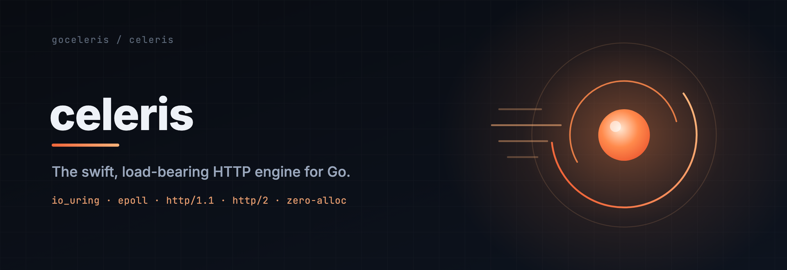

<p align="center">
  
</p>

<p align="center">
  <a href="https://github.com/goceleris/celeris/actions/workflows/ci.yml?query=branch%3Amain"></a>
  <a href="https://codecov.io/gh/goceleris/celeris"></a>
  <a href="https://codspeed.io/goceleris/celeris"></a>
  <a href="https://scorecard.dev/viewer/?uri=github.com/goceleris/celeris"></a>
  <a href="https://github.com/goceleris/celeris/releases/latest"></a>
  <a href="go.mod"></a>
</p>

<p align="center">
  <strong>celeris is a Go HTTP server built on per-core epoll or io_uring event loops, with a route-group and middleware API in the style of Gin and Echo.</strong><br>
  It serves HTTP/1.1 and cleartext HTTP/2, and ships 36 middleware packages and first-party PostgreSQL, Redis and memcached clients (the clients are in beta).
</p>

<p align="center">
  It is for Go developers who want an event-loop server behind a familiar API and run it on Linux. On macOS and Windows it runs on <code>net/http</code>, for development.
</p>

<p align="center">
  <a href="#quick-start">Quick start</a> ·
  <a href="#performance">Performance</a> ·
  <a href="#status-and-stability">Status</a> ·
  <a href="https://goceleris.dev">Documentation</a> ·
  <a href="https://pkg.go.dev/github.com/goceleris/celeris">API reference</a> ·
  <a href="https://github.com/goceleris/celeris/releases/tag/v1.6.0">Release notes</a>
</p>

## Quick start

```
go get github.com/goceleris/celeris@latest
```

```go
package main

import (
	"log"

	"github.com/goceleris/celeris"
)

func main() {
	s := celeris.New(celeris.Config{Addr: ":8080"})
	s.GET("/hello", func(c *celeris.Context) error {
		return c.String(200, "Hello, World!")
	})
	log.Fatal(s.Start())
}
```

Requires Go 1.27.4 or newer. On Linux, celeris runs pinned per-core event loops on epoll (kernel 5.10 or later) or io_uring (5.19 or later); the default `Adaptive` engine starts on epoll and moves to io_uring under sustained load where the kernel allows it. On other systems, or when you choose `Std`, it runs on `net/http`. Handlers run inline on an event loop, so mount a route that blocks on I/O (a database or network call) with `.Async()`. [Engines](https://goceleris.dev/docs/engines) has the details.

Use `StartWithContext` for production; when the context is cancelled the server drains in-flight requests up to `ShutdownTimeout` (default 30s). [Graceful shutdown](https://goceleris.dev/docs/graceful-shutdown) describes what a connection gets.

```go
ctx, stop := signal.NotifyContext(context.Background(), os.Interrupt, syscall.SIGTERM)
defer stop()

s := celeris.New(celeris.Config{Addr: ":8080", ShutdownTimeout: 15 * time.Second})
s.GET("/hello", func(c *celeris.Context) error { return c.String(200, "Hello, World!") })
if err := s.StartWithContext(ctx); err != nil {
	log.Fatal(err)
}
```

## Why celeris

- **Event loops, not a goroutine per connection.** Pinned per-core loops on Linux; `Std` on `net/http` elsewhere.
- **A familiar API.** Route groups, named parameters, middleware, error-returning handlers, and `celeris.Adapt` to reuse a `net/http` handler.
- **36 middleware packages in the repository.** Authentication, CORS, sessions, rate limiting, caching, compression, Prometheus and OpenTelemetry ([list](https://goceleris.dev/docs/middleware)).
- **Database clients.** PostgreSQL, Redis and memcached, in beta, with no CGo ([details](https://goceleris.dev/docs/data-stores)).
- **Streaming.** WebSocket with a fan-out `Hub`, Server-Sent Events with a `Broker`, `StreamWriter` and `Detach`.
- **Allocation discipline.** Request contexts are pooled, and the core request paths are held to zero allocations by tests.
- **Small dependency surface.** The root module depends directly on `golang.org/x/sys` and `golang.org/x/net` only.

## Performance

[figure: hero chart, filled from the cut-commit screen]

*Plaintext GET, 1024 connections, requests per second, best configuration per framework, linux/amd64, run of [figure: run date, filled from the cut-commit screen].*

On plaintext GET with 1024 connections on linux/amd64, celeris's best configuration ranks first of [figure: number of frameworks, filled from the cut-commit screen] frameworks: [figure: margin over the next server, filled from the cut-commit screen] ahead of the next server and [figure: ratio, filled from the cut-commit screen] times `net/http`.

| Requests per second, plaintext GET, 1024 connections | celeris, best configuration | next server overall | `net/http` |
|---|---|---|---|
| linux/amd64 | [figure: filled from the cut-commit screen] | [figure: filled from the cut-commit screen] | [figure: filled from the cut-commit screen] |
| linux/arm64 | [figure: filled from the cut-commit screen] | [figure: filled from the cut-commit screen] | [figure: filled from the cut-commit screen] |

Celeris is not ahead on every row: the full results show where another server is level or ahead, and [Known limits](#known-limits) lists a light-load tail-latency gap.

The figures come from a cross-framework benchmark on dedicated x86-64 and arm64 machines, driven by one load generator ([loadgen](https://github.com/goceleris/loadgen)) from a separate host. No tail-latency ranking is claimed from these runs: their latency passes carry a known load-generator limit ([loadgen#102](https://github.com/goceleris/loadgen/issues/102)). [How the numbers are made](https://goceleris.dev/methodology/); [full results and how to read them](https://goceleris.dev/docs/results).

## Status and stability

- **Compatibility.** [GOVERNANCE.md](GOVERNANCE.md#compatibility) says: "From v1.6.0, the supported API is every exported identifier of the packages that have no `internal` element in their import path and are not marked experimental" (the list of packages follows there), and a supported package "does not remove or change an exported identifier, a documented default or documented behaviour in a way that breaks code that uses it as documented. A change that would do so needs a new major version." The exported API is checked in CI against the golden files in [`api/`](api/).
- **Database clients (beta).** The exported API of the PostgreSQL, Redis and memcached clients stays under the compatibility check, but behaviour fixes (what a value scans to, which cases return an error) may land in minor releases and are listed in the release notes. Supported types and gaps per client: [PostgreSQL](https://goceleris.dev/docs/postgres-types), [Redis](https://goceleris.dev/docs/redis-replies), [memcached](https://goceleris.dev/docs/memcached-behavior).
- **Maturity.** celeris is a young project with one maintainer ([MAINTAINERS.md](MAINTAINERS.md)). Benchmark it on your own workload.
- **Testing.** Every pull request runs lint (with the `api/` check), unit, conformance and driver conformance tests, and a build. [probatorium](https://github.com/goceleris/probatorium) separately runs celeris on dedicated x86-64 and arm64 machines against malformed traffic, connection churn and fault injection.

## What's new in v1.6.0

- The first release under the compatibility promise above.
- Upgrading from v1.5.x needs code changes (removed deprecated API, internal packages, new defaults): start with the upgrade guide at the top of the [release notes](https://github.com/goceleris/celeris/releases/tag/v1.6.0).
- `Shutdown` now returns only after the drain on every engine, two ways an HTTP/2 request could crash the process on the native engines are fixed, and the database clients got many fixes for wrong results and hangs.

## Known limits

- **No TLS in the native engines.** celeris has no TLS configuration: the io_uring, epoll and `Adaptive` engines serve cleartext only, `Std` serves HTTPS only from a TLS listener you pass in, and otherwise you terminate TLS in a proxy in front ([#446](https://github.com/goceleris/celeris/issues/446)).
- **Linux is the production platform.** macOS and Windows run the `Std` engine, for development and testing.
- **The database clients are beta** (see Status above).
- **Idle CPU with open connections.** On the native engines, a server that holds connections open and is otherwise idle uses more CPU than a plain `net/http` server ([#1478](https://github.com/goceleris/celeris/issues/1478)).
- **Light-load tail latency.** At light load the native engines' WebSocket echo p99 was about twice the `Std` engine's in two arm64 measurements ([#1318](https://github.com/goceleris/celeris/issues/1318), [#1380](https://github.com/goceleris/celeris/issues/1380)); not measured for HTTP. Where tail latency at light load matters more to you than peak throughput, use the `Std` engine.

The full list for v1.6.0, with issue links, is in [Known limits in v1.6.0](https://goceleris.dev/docs/known-limits).

## Contributing and governance

See [CONTRIBUTING.md](CONTRIBUTING.md) to contribute, and [GOVERNANCE.md](GOVERNANCE.md) for roles, releases and the compatibility promise. Related projects: [loadgen](https://github.com/goceleris/loadgen), [probatorium](https://github.com/goceleris/probatorium) and [docs](https://github.com/goceleris/docs) (the source of [goceleris.dev](https://goceleris.dev)).

## License

[Apache License 2.0](LICENSE)
